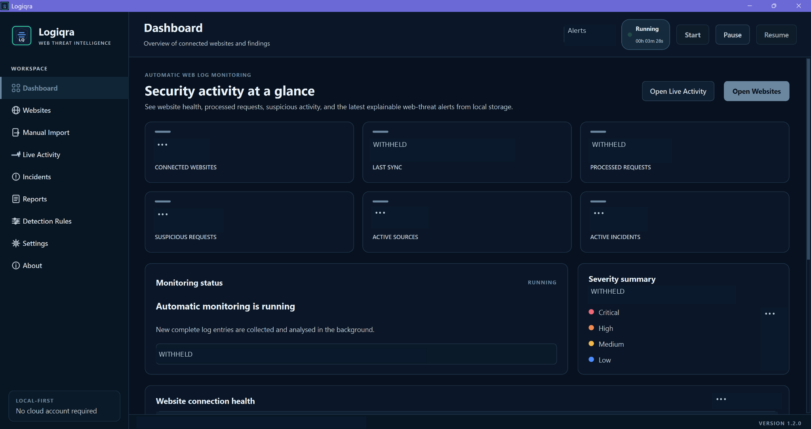
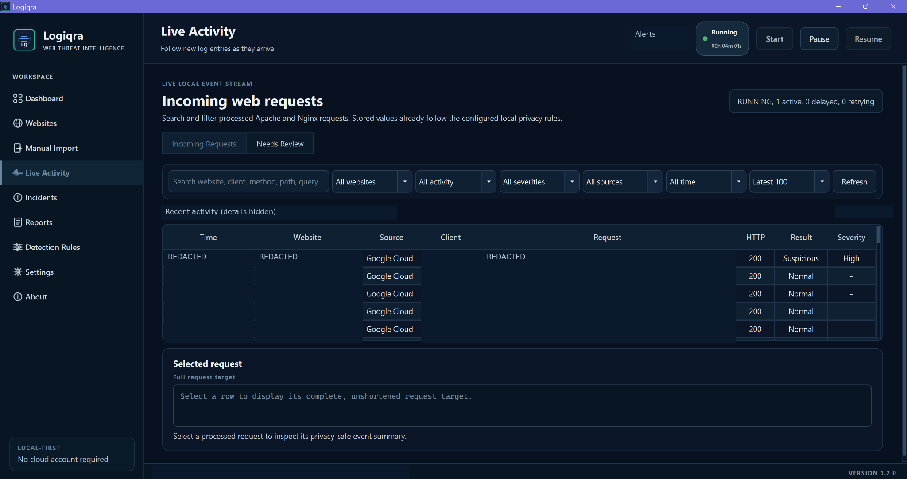
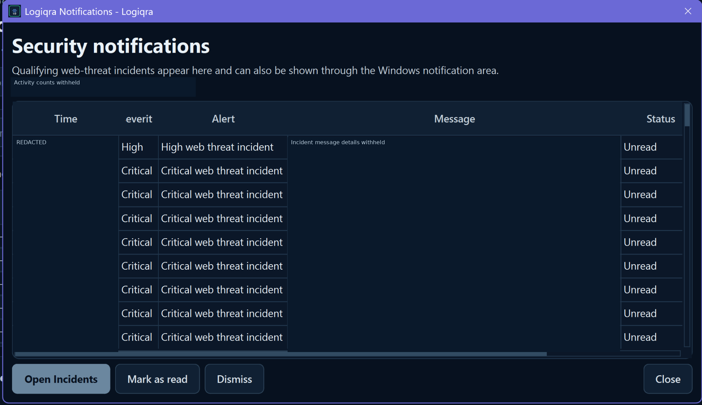
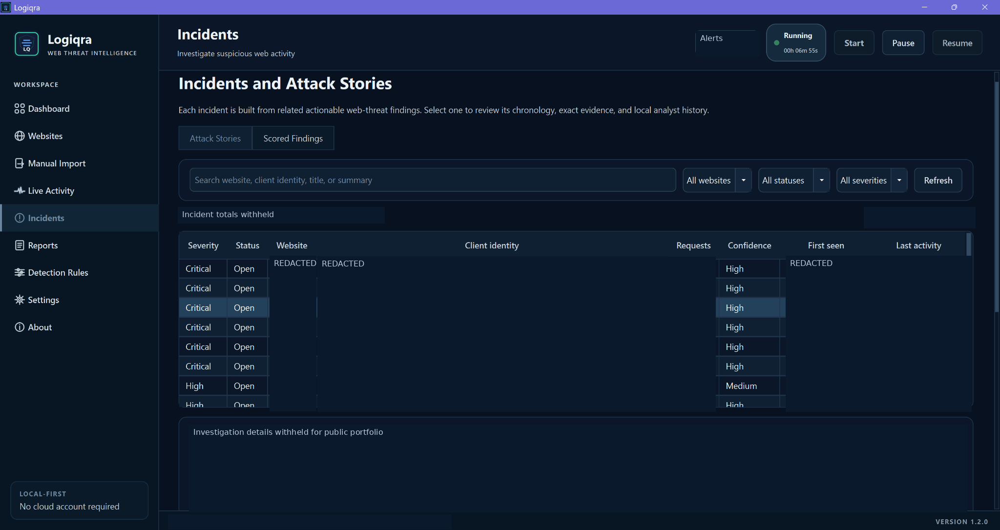
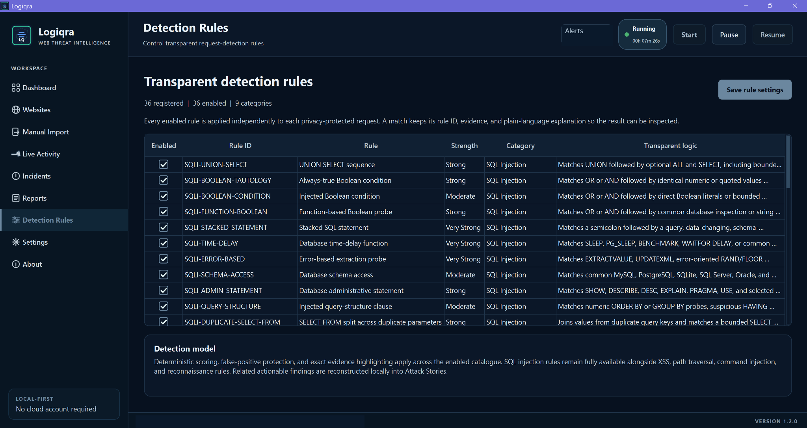
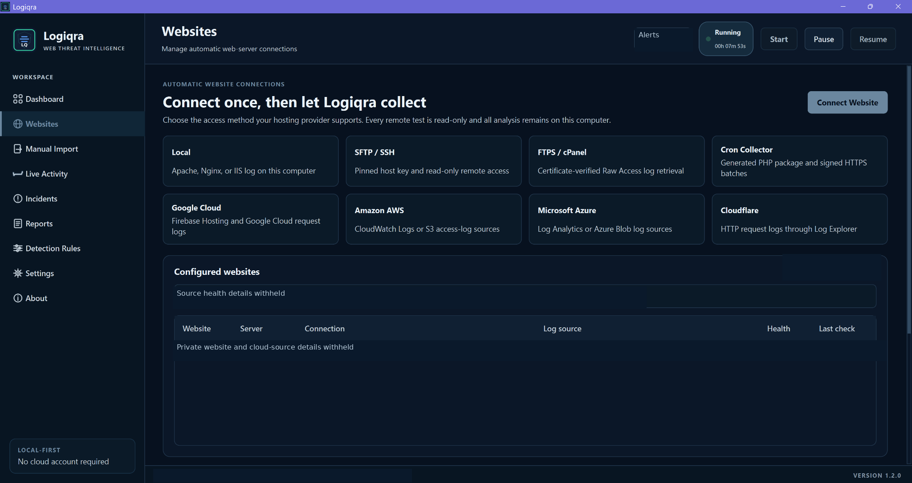
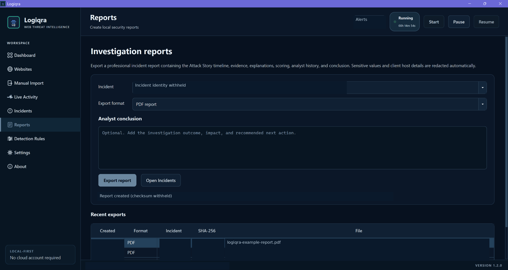
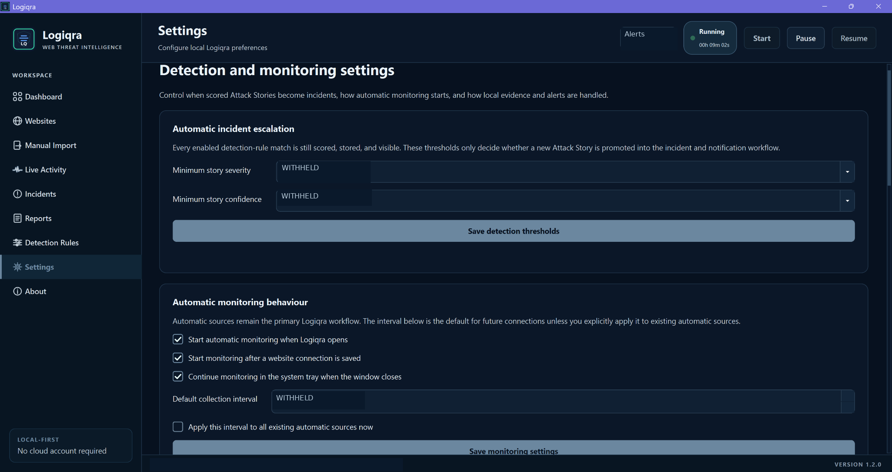
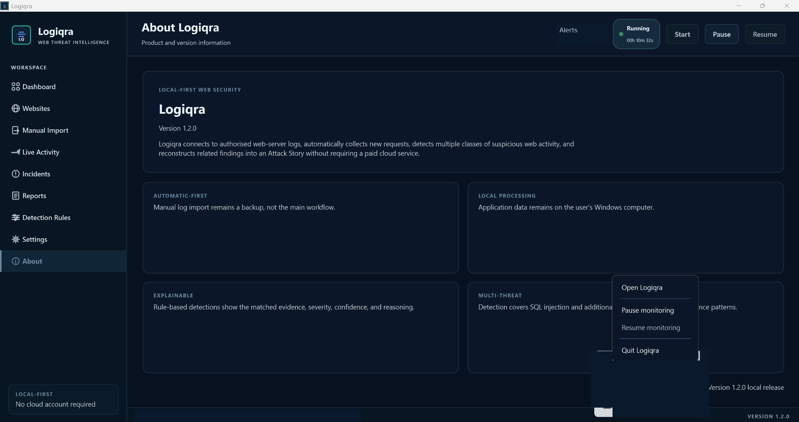

# Logiqra

**Local-first Windows cybersecurity software for continuous web-log monitoring, explainable threat detection, incident investigation, and reporting.**

Logiqra analyses authorised website and web-server logs, identifies suspicious request patterns, and helps users investigate related activity. It is built for security learning, blue-team investigation, and authorised operational monitoring.

| | |
|---|---|
| **Current application version** | **1.2.0** |
| **Platform** | Windows 10 / 11 (Windows 11 release validation completed) |
| **Distribution** | Proprietary freeware |
| **Developer** | Vincent Oli |
| **Source code** | Private; this is the public product showcase |

> **Download status:** The Logiqra 1.2.0 Windows installer has been built and validated locally, but **has not yet been published to this repository's Releases page**. The older v1.1.3 release shown on GitHub is historical and is **not** the current Logiqra installer. Please do not mistake it for the latest version.

## What Logiqra does

Logiqra brings supported log sources into a local analysis workflow so investigators can move from individual requests to explainable findings, incident records, and reports.

### Monitoring and log sources

- Automatic monitoring of supported local Apache, XAMPP, and Nginx access logs
- Structured IIS log ingestion where supported
- Read-only SFTP/SSH access to authorised remote logs
- Protected FTPS/cPanel log collection
- HTTPS Cron Micro-Collector for compatible hosting environments
- Google Cloud Logging / Firebase-related log sources when supported logs and permissions are available
- Additional supported cloud-source integrations
- Manual log import for offline analysis
- Monitoring checkpoints, log-rotation handling, and duplicate protection
- Windows system-tray operation, including restoring the existing window from the Start menu

Availability of specific detections depends on the fields, completeness, and format of the collected logs.

### Explainable threat detection

Logiqra includes detection logic for suspicious web requests and behaviours, including:

- SQL injection
- Cross-site scripting (XSS)
- Path traversal
- Command injection
- Suspicious scanning and automated probing
- Rapid authentication attempts and password-guessing indicators
- Restricted-path or administrative-page probing
- Possible data-exfiltration indicators where logs provide sufficient evidence

Findings can include matched evidence, explanations, severity, confidence, and related activity. Rule preferences allow users to tailor the detection workflow.

A suspicious request is **not proof of a successful compromise**. Human review and source context remain essential.

### Investigation and reporting

- Live Activity view with recent-event time filters
- Dashboard, alerts, and detection rules
- Incident review and status management
- Attack Story reconstruction to correlate related activity
- PDF, CSV, and JSON report exports
- Privacy-aware handling of evidence and sensitive values
- Local SQLite storage and Windows Credential Manager integration
- Database backups and privacy-conscious diagnostics

## How it works

~~~mermaid
flowchart LR
    A["Authorised log source"] --> B["Collection and checkpoint"]
    B --> C["Parsing and normalisation"]
    C --> D["Privacy-aware analysis"]
    D --> E["Detection and risk scoring"]
    E --> F["Findings and Attack Stories"]
    F --> G["Dashboard, incidents, reports"]
~~~

Logiqra is an **analysis and investigation tool**. It does not automatically block attacks, fix vulnerabilities, or replace secure application design, patching, access control, or professional incident response.

## Windows verification for version 1.2.0

The latest Batch 3 installer was built using the Windows release-validation workflow.

| Validation | Result |
|---|---|
| Python source foundation check | Passed |
| Ruff | Passed |
| mypy | Passed; 116 source files checked |
| Automated tests | **1,059 passed** |
| Overall measured test coverage | **86%** |
| Windows installer build | Completed successfully |

The post-install checks also confirmed successful Start-menu window restoration, Logiqra-prefixed PDF/CSV/JSON export filenames, and readable warning dialogs. One minor visual improvement remains planned: increasing the visibility of the ice-blue Live Activity indicator glow.

These results describe the tested environment and do not guarantee universal threat-detection accuracy or compatibility with every log source.

## Installation and releases

**Logiqra 1.2.0 public release assets are being prepared.** Once published, this section will provide the official installer link and matching SHA-256 checksum verification instructions.

Please avoid treating the historical v1.1.3 installer as the current application. Keep your database and application data when upgrading; do not manually delete them to install a newer version.

The project maintains its original development history. Previous commits, release records, and some older screenshots/documentation may reflect an earlier product name and are retained for historical traceability, not as current branding.

## Documentation and screenshots

Current Logiqra 1.2.0 documents:

- [Installation and upgrade guide](docs/LOGIQRA_INSTALLATION_GUIDE.md)
- [User guide](docs/LOGIQRA_USER_GUIDE.md)
- [Technical architecture](docs/LOGIQRA_TECHNICAL_ARCHITECTURE.md)
- [Security and privacy](docs/LOGIQRA_SECURITY_AND_PRIVACY.md)
- [Windows validation report](docs/LOGIQRA_VERSION_1_2_0_VALIDATION.md)
- [Changelog](CHANGELOG.md)
- [Security policy](SECURITY.md)
- [Notice](NOTICE.md)

## Logiqra 1.2.0 screenshots

The images below are from the **Logiqra 1.2.0 Windows application**. They have been edited specifically for public display: real website and cloud-project identifiers, client IP addresses, event timestamps, detailed requests, incident evidence, report hashes and file paths, operational totals, and unrelated system-tray items have been **masked or replaced with explicit example labels**. Redacted labels are not live product data.

### Dashboard

### Live Activity

### Security notifications

### Incidents and Attack Stories

### Detection Rules

### Website Connections

### Reports

### Settings

### About and system-tray menu

Older product screenshots can still be found in the repository's previous commits, as part of its development history.

## Privacy and responsible use

Logiqra is designed for authorised security monitoring. Use it only with websites, servers, hosting accounts, or log files you own or have explicit permission to assess.

- Treat web logs, evidence, reports, and credentials as sensitive.
- Do not commit real customer logs, database files, secrets, API keys, or cloud credentials.
- Review alerts in context; false positives and incomplete visibility are possible.
- Access-log analysis cannot reliably identify attacks whose relevant payloads are absent from the log fields.

## Licence and source availability

Logiqra is distributed as **proprietary freeware**. The complete application source code is not published in this showcase repository. The current [Logiqra licence](LICENSE.txt) is **Licence Version 1.0, applicable to Logiqra 1.2.0**. Before publishing the new installer, its bundled licence must be checked against this document.

Historical licence and release files relate to their respective prior versions and should not be interpreted as permission to modify or redistribute the private source code.

## Author

**Vincent Oli**

Designed and developed as a Windows cybersecurity product covering log ingestion, explainable detection, incident investigation, automated testing, data protection, packaging, and release validation.
