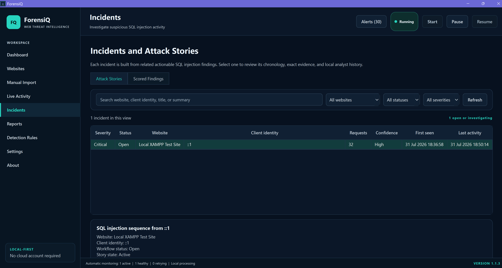
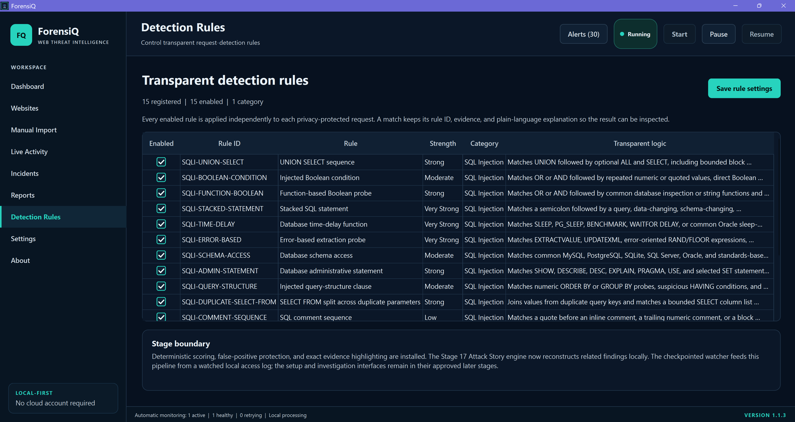
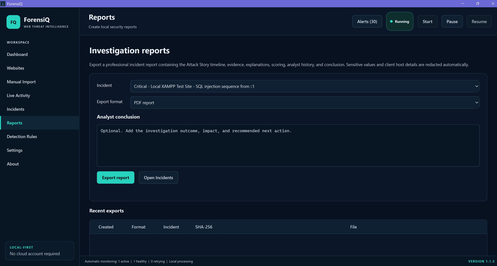
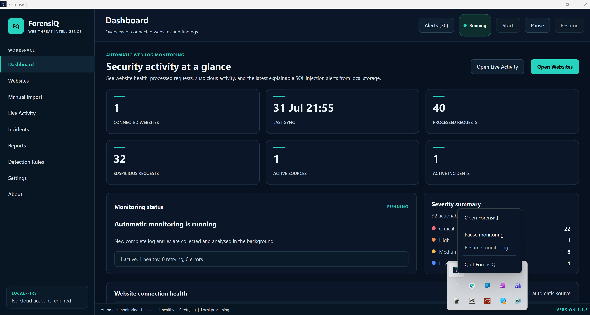
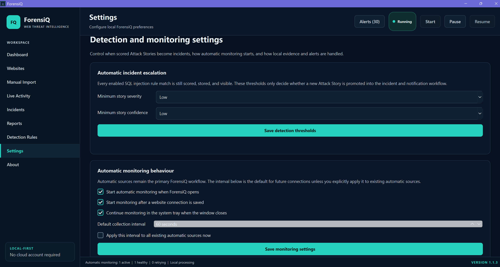
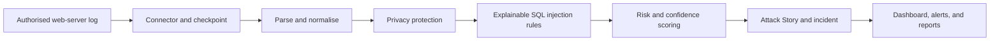

# ForensiQ

**Local-first Windows software for automatic web-server log monitoring, explainable SQL-injection detection, Attack Story reconstruction, and privacy-aware reporting.**

ForensiQ helps users connect authorised Apache, XAMPP, or Nginx access logs, monitor new activity automatically, identify suspicious SQL-injection patterns, investigate related requests as Attack Stories, and export structured reports.

**Current release:** Version 1.1.3  
**Platform:** Windows 10 and Windows 11  
**Distribution:** Proprietary freeware  
**Developer:** Vincent Oli

> The complete ForensiQ source code is maintained privately. This public repository contains the product showcase, documentation, screenshots, validation evidence, release information, and downloadable Windows installer.

---

## Product overview

ForensiQ was built as a complete cybersecurity software product, from requirements and architecture through implementation, testing, debugging, packaging, and release validation.

It is designed for lawful and authorised monitoring of websites, servers, hosting accounts, and log files owned or managed by the user.

### Main capabilities

- Automatic monitoring of local Apache, XAMPP, and Nginx access logs
- Read-only SFTP/SSH monitoring
- FTPS/cPanel Raw Access monitoring
- Cron Micro-Collector support for compatible shared hosting
- Manual import fallback for supported Apache and Nginx logs
- Explainable SQL-injection detection
- Severity and confidence scoring
- Duplicate and retry protection
- Log rotation and checkpoint recovery
- Attack Story reconstruction
- Incident workflow with notes and statuses
- Local notifications and Windows tray operation
- PDF, CSV, and JSON reporting
- Privacy-aware evidence redaction
- Local SQLite storage
- Windows Credential Manager integration
- Verified backups and privacy-safe diagnostics
- No mandatory cloud backend, paid API, AI model, or subscription

---

## Screenshots

### Dashboard


### Live Activity


### Incidents and Attack Stories



### Detection Rules



### Reports



### System-tray controls



### Settings



---

## How ForensiQ works



Every supported log source enters the same local analysis pipeline.

This keeps detection behaviour consistent across:

- Local live logs
- SFTP/SSH sources
- FTPS/cPanel sources
- Cron Micro-Collector batches
- Manual imports

---

## Supported connection methods

| Method | Purpose |
|---|---|
| Local log file | Monitor Apache, XAMPP, or Nginx logs on the Windows computer |
| SFTP/SSH | Read authorised remote log ranges through a verified read-only connection |
| FTPS/cPanel | Retrieve authorised cPanel Raw Access logs over protected FTPS |
| Cron Micro-Collector | Pull signed batches from compatible shared hosting through HTTPS |
| Manual Import | Analyse historical or emergency log files using the same pipeline |

Remote connectors use outbound connections. ForensiQ does not require an inbound public Windows port.

---

## Explainable detection

ForensiQ Version 1 focuses on SQL-injection detection.

The rule engine is deterministic and explainable. Findings can include:

- Rule identifier
- Matched evidence
- Plain-English explanation
- Confidence
- Risk score
- Severity
- Scoring factors
- Related request
- Related Attack Story

Version 1.1.3 includes controlled coverage for patterns such as:

- Boolean conditions
- `UNION SELECT`
- Time-delay functions
- Error-based functions
- Signed and unsigned conversion probes
- Numeric `ORDER BY` and `GROUP BY`
- `HAVING`
- Administrative commands
- Schema enumeration
- Stacked statements
- Quotes and comments
- SQL keywords split with block comments
- Duplicate-parameter reconstruction
- Split `SELECT ... FROM` statements
- Function-based Boolean expressions

The software also includes narrow false-positive protection for harmless educational searches.

---

## Validation results

ForensiQ 1.1.3 completed a clean controlled localhost regression containing:

| Category | Result |
|---|---:|
| Malicious requests | 32 |
| Malicious requests detected | 32 |
| Malicious requests missed | 0 |
| Benign controls | 8 |
| Benign controls classified as Normal | 8 |
| False positives | 0 |
| Overall controlled result | 40 of 40 |

The final controlled result was:

```text
Detection rate: 100%
Benign accuracy: 100%
Overall controlled accuracy: 100%
```

These figures apply only to the documented controlled test set. They do not guarantee identical performance against every real-world application, log format, encoding, or attack variation.

Read the complete validation report:

[ForensiQ Version 1.1.3 Validation](docs/FORENSIQ_VERSION_1_1_3_VALIDATION.md)

---

## Download and installation

Download the latest Windows installer from the **Releases** section of this repository.

Expected release assets:

```text
ForensiQ-1.1.3-Setup.exe
SHA256SUMS.json
LICENSE.txt
```

Before installing, verify the installer checksum in PowerShell:

```powershell
Get-FileHash .\ForensiQ-1.1.3-Setup.exe -Algorithm SHA256
```

Compare the result with the matching value in `SHA256SUMS.json`.

The current portfolio release may be unsigned. Install it only when obtained from the official ForensiQ release page and after verifying its checksum.

Full instructions:

[Installation Guide](docs/FORENSIQ_INSTALLATION_GUIDE.md)

---

## Privacy and security

ForensiQ is local-first.

- Analysis and permanent storage remain on the user's Windows computer
- Secrets are stored through Windows Credential Manager
- SQLite stores only non-secret credential references
- Reports and diagnostics apply privacy redaction
- Remote connectors use protected, read-only connections
- Plain FTP and unverified TLS are not supported
- Diagnostic ZIPs exclude the database and saved credentials
- Backups receive SHA-256 checksums

Read more:

[Security and Privacy](docs/FORENSIQ_SECURITY_AND_PRIVACY.md)

[Security Policy](SECURITY.md)

---

## Documentation

- [Installation Guide](docs/FORENSIQ_INSTALLATION_GUIDE.md)
- [User Guide](docs/FORENSIQ_USER_GUIDE.md)
- [Technical Architecture](docs/FORENSIQ_V1_TECHNICAL_ARCHITECTURE.md)
- [Security and Privacy](docs/FORENSIQ_SECURITY_AND_PRIVACY.md)
- [Version 1.1.3 Validation](docs/FORENSIQ_VERSION_1_1_3_VALIDATION.md)
- [Changelog](CHANGELOG.md)
- [Security Policy](SECURITY.md)
- [Notice](NOTICE.md)
- [Licence](LICENSE.txt)

---

## Product limitations

ForensiQ analyses supported web-server access logs.

It does not:

- Automatically block attacks
- Patch vulnerable applications
- Modify monitored servers
- Replace secure coding
- Replace parameterised database queries
- Replace patching, backups, access control, or network security
- Guarantee detection of every malicious request
- Guarantee that every alert is a real attack
- Detect body-only payloads when the access log does not contain the request body
- Replace professional incident-response judgement

Findings should be reviewed in context before action is taken.

---

## Responsible use

Use ForensiQ only with systems, websites, hosting accounts, servers, and log files that you own or are expressly authorised to monitor.

Do not use it to access, probe, disrupt, monitor, or analyse third-party systems without permission.

---

## Licence

ForensiQ is distributed as **proprietary freeware**.

Users may download, install, and use the unmodified official release free of charge for lawful and authorised purposes.

The licence prohibits activities including:

- Modification
- Redistribution
- Resale
- Reverse engineering, except where applicable law cannot restrict it
- Removal of branding or copyright notices
- Claiming authorship
- Unauthorised monitoring or harmful use

Read the complete terms in [LICENSE.txt](LICENSE.txt).

---

## Author

**Vincent Oli**

Developed as a complete cybersecurity software product, from requirements and architecture through implementation, testing, debugging, packaging, and release validation.
