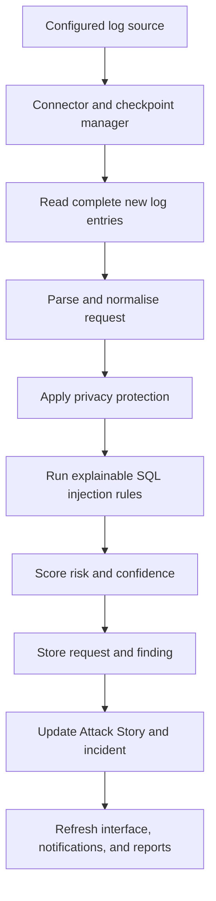

# ForensiQ Technical Architecture

This document describes the public technical architecture of **ForensiQ 1.1.3**.

ForensiQ is a local-first Windows desktop application for automatic web-server log collection, explainable SQL-injection detection, incident reconstruction, and privacy-aware reporting.

The complete implementation source remains private. This document presents the product architecture, security boundaries, and processing model without exposing private code.

## 1. Architecture overview

ForensiQ runs primarily on the user's Windows computer.

Its major local components are:

- PySide6 desktop interface
- Monitoring coordinator
- Connector layer
- Checkpoint manager
- Apache and Nginx parser
- Request normaliser
- Explainable SQL-injection rule engine
- Scoring and evidence pipeline
- Attack Story reconstruction
- SQLite storage
- Windows Credential Manager integration
- Local notifications
- PDF, CSV, and JSON reporting
- Backup and diagnostic services

ForensiQ does not require:

- A ForensiQ cloud backend
- A paid API
- An AI model
- A subscription
- An inbound public Windows port

Remote monitoring uses outbound connections from ForensiQ to a user-authorised hosting source.

## 2. High-level processing flow



Every supported source enters the same analysis pipeline.

This keeps detection behaviour consistent across:

- Local live logs
- SFTP/SSH
- FTPS/cPanel
- Cron Micro-Collector
- Manual Import

## 3. Runtime components

| Component | Responsibility |
|---|---|
| Desktop interface | Website setup, monitoring controls, Dashboard, Live Activity, Detection Rules, Incidents, Reports, Settings, notifications, and maintenance actions. |
| Monitoring coordinator | Starts enabled sources, schedules checks, handles retries, and coordinates source-specific workers. |
| Connector layer | Reads only new log content from supported local or remote sources. |
| Checkpoint manager | Stores the last safely processed source position and prevents duplicate analysis. |
| Parser and normaliser | Converts supported Apache and Nginx access-log entries into one internal request format. |
| Privacy layer | Redacts or masks sensitive evidence before permanent storage and export. |
| SQL-injection rule engine | Applies transparent Version 1 rules and records matched evidence, explanations, confidence, and severity. |
| Scoring pipeline | Produces deterministic confidence and risk results from explainable factors. |
| Attack Story builder | Groups related suspicious requests into a chronological sequence. |
| Incident service | Maintains one durable incident per actionable Attack Story and records analyst workflow history. |
| SQLite storage | Stores non-secret application data locally. |
| Credential vault adapter | Stores passwords, passphrases, and collector secrets through Windows Credential Manager. |
| Notification service | Creates durable in-app alerts and optional Windows tray notifications. |
| Reporting service | Exports privacy-redacted PDF, CSV, and JSON reports. |
| Maintenance services | Perform integrity checks, verified backups, bounded logs, and privacy-safe diagnostics. |

## 4. Connector architecture

All automatic connectors follow the same internal lifecycle:

1. Validate the configuration.
2. Test the selected source using read-only access.
3. Identify the current physical log source.
4. Read only complete entries newer than the stored checkpoint.
5. Return a bounded batch plus source metadata.
6. Parse, protect, analyse, and store the batch locally.
7. Advance the checkpoint only after successful storage.
8. Report a clear health state without exposing credentials.
9. Retry temporary failures without deleting the configuration.
10. Resume from the saved checkpoint after restart.

### 4.1 Local log watcher

The local connector:

- Watches a selected Apache, XAMPP, or Nginx access log
- Reacts to operating-system file changes
- Performs periodic catch-up checks
- Reads only complete newly appended entries
- Keeps a partial final line pending until its newline arrives
- Detects truncation and log rotation
- Recovers unread rotated-file content when available
- Requires no internet connection

### 4.2 SFTP/SSH

The SFTP connector:

- Makes outbound, read-only connections
- Verifies the exact SHA-256 SSH host-key fingerprint
- Supports protected passwords, SSH agent or default keys, and optional identity files
- Reads only the required remote byte ranges
- Does not run remote shell commands
- Handles temporary disconnection and log rotation
- Closes each short-lived connection after catch-up

### 4.3 FTPS/cPanel

The FTPS connector:

- Uses explicit FTPS
- Requires trusted certificate and hostname verification
- Requires TLS 1.2 or newer
- Uses a protected data channel
- Uses passive, read-only metadata and retrieval operations
- Does not fall back to plain FTP
- Applies the same checkpoint and duplicate-protection model as other connectors

### 4.4 Cron Micro-Collector

The Cron Micro-Collector:

- Runs as a small PHP 8.1 component on supported shared hosting
- Reads only the authorised access log
- Stores complete new entries in a bounded private queue
- Exposes batches through a private HTTPS endpoint
- Uses a collector identifier and secret
- Signs batches with HMAC-SHA256
- Includes byte ranges and SHA-256 digests
- Rejects altered, incomplete, overlapping, gapped, or misdirected batches
- Keeps unacknowledged batches available during Windows downtime
- Requires no inbound Windows port, fixed public IP, paid server, or ForensiQ cloud account

### 4.5 Manual Import

Manual Import:

- Accepts supported Apache or Nginx log files
- Supports plain and signature-verified Gzip input
- Rejects ZIP containers
- Applies the same privacy, parsing, detection, scoring, evidence, duplicate, and Attack Story pipeline
- Uses one local transaction for related records
- Remains a fallback path rather than an automatic source

## 5. Checkpoint and duplicate protection

ForensiQ maintains one independent checkpoint for each configured source.

A checkpoint records information such as:

- Source identity
- Source generation
- Last safely processed byte position
- Source fingerprint
- Latest processed entry time
- Stable batch identifier
- Rotation-recovery anchor

The checkpoint advances only after the corresponding batch has been stored successfully.

This design protects against:

- Reprocessing after restart
- Duplicate records during retry
- Partial writes
- Rename-and-recreate rotation
- Copy-truncate rotation
- Temporary remote failures
- Failed acknowledgements
- Stale workers overwriting newer progress

## 6. Background execution and responsiveness

The PySide6 interface remains on the Windows UI thread.

Potentially expensive work runs outside the UI thread, including:

- Connection checks
- File reading
- Parsing
- Normalisation
- Detection
- Scoring
- Incident reconstruction
- Storage operations

Workers communicate with the interface through thread-safe events and Qt signals.

Version 1.1.1 introduced additional responsiveness controls:

- Model-based Live Activity table
- Latest 100, 250, or 500 row limits
- Controlled refresh coalescing
- No heavy refreshes for hidden pages
- Independent Needs Review refresh
- One highest-priority active finding per request row
- Immediate cancellation of unnecessary Live Activity refresh work when navigating away

These controls prevent large request histories from freezing the desktop interface.

## 7. Internal request model

A parsed request can contain:

- Website and source identity
- Timestamp
- Client network identity
- HTTP method
- Request path and query string
- Protocol
- Response status
- Response size
- Referrer
- User agent
- Parser type
- Parse status
- Privacy-protected source evidence

A detection finding can contain:

- Related request
- Rule identifier
- Matched evidence
- Plain-English explanation
- Confidence score and band
- Risk score and severity
- Transparent scoring factors
- Detection time
- Related Attack Story
- Actionability state

## 8. Explainable detection model

ForensiQ Version 1 focuses on SQL-injection detection.

The rule engine uses deterministic, explainable patterns rather than an external AI service.

The Version 1.1 series added coverage for:

- Boolean conditions
- Time-delay functions
- `UNION SELECT`
- Error-based functions
- `CAST(... AS SIGNED/UNSIGNED)`
- Numeric `ORDER BY` and `GROUP BY`
- `HAVING`
- Administrative commands
- Schema enumeration
- Stacked statements
- Isolated quote probes
- Block comments inserted inside SQL keywords
- Duplicate-parameter reconstruction
- Split `SELECT ... FROM`
- Function-based Boolean expressions

False-positive controls include narrow treatment of successful educational searches containing terms such as:

- `union select tutorial`
- `show tables documentation`
- `case when examples`
- `sleep function tutorial`

The original audit match can remain stored even when the request is treated as non-actionable.

## 9. Attack Story and incident model

ForensiQ groups related suspicious requests into persistent Attack Stories.

A story can include:

- Chronological request sequence
- Relationship reasons
- Rule matches
- Evidence
- Severity progression
- Client network identity
- Website identity
- First and latest activity times

Each actionable Attack Story maps to one durable incident.

Supported workflow states are:

- Open
- Investigating
- Resolved
- Dismissed

Status changes and analyst notes are stored as append-only history.

A resolved or dismissed incident can reopen when new actionable activity enters the same Attack Story.

## 10. Local storage boundary

ForensiQ stores non-secret data in a local SQLite database.

Logical storage areas include:

| Area | Purpose |
|---|---|
| Websites | Configured websites and non-secret connection settings |
| Checkpoints | Last safely processed source positions |
| Requests | Parsed requests and protected evidence |
| Findings | Rule matches, evidence, confidence, and severity |
| Attack Stories | Reconstructed suspicious activity sequences |
| Incidents | Durable investigation records |
| Incident history | Analyst notes and status changes |
| Alerts | Notification state and acknowledgement history |
| Monitor events | Connection, retry, recovery, and health history |
| Reports | Export records and checksums |
| Settings | Non-secret user preferences |

SQLite writes use transactions and parameterised statements.

Secrets are not stored in SQLite.

## 11. Credential security

Connection secrets are handled through Windows Credential Manager.

ForensiQ stores only a non-secret credential reference in SQLite.

Protected values can include:

- SFTP passwords
- FTPS passwords
- SSH key passphrases
- Collector secrets

Secrets are requested only when a connector needs to authenticate.

They are not written to:

- Application logs
- Reports
- Alerts
- Diagnostic packages
- Public configuration files
- Error messages

## 12. Privacy controls

ForensiQ protects sensitive request evidence before permanent storage.

Protected data can include:

- Password parameters
- Authorization headers
- Cookies
- Session identifiers
- JWTs
- API keys
- Common token fields
- Sensitive query values

Client IP handling supports:

- Full address retention
- IPv4 `/24` masking
- IPv6 `/64` masking

Reports and diagnostics apply additional redaction.

## 13. Reliability and failure handling

ForensiQ is designed so that:

- One malformed log entry does not stop monitoring
- One failed website does not stop another
- Checkpoints advance only after successful storage
- Temporary network failures trigger controlled retry
- Rotation does not cause complete historical reprocessing
- Duplicate batches do not create duplicate requests
- Database schema changes use versioned migrations
- Automatic monitoring performs a database preflight check
- Backups are created only after integrity checks
- Unexpected errors are written to bounded, redacted local logs

## 14. Reporting architecture

The reporting layer exports selected incidents as:

- PDF
- CSV
- JSON

Reports can include:

- Attack Story timeline
- Relationship reasons
- Request evidence
- Matched rules
- Scoring factors
- Analyst history
- Conclusion

Exports:

- Redact sensitive values
- Mask host-level client identity
- Refuse accidental overwrite
- Use atomic file creation
- Receive a SHA-256 checksum
- Create a local audit record

## 15. Maintenance architecture

ForensiQ provides:

- SQLite integrity and foreign-key checks
- Verified local database backups
- Bounded backup retention
- Privacy-safe diagnostic ZIPs
- Rotating runtime logs
- Single-instance protection
- Release-content verification
- SHA-256 release manifests

Equivalent command-line actions are:

```powershell
ForensiQ.exe --check
ForensiQ.exe --backup
ForensiQ.exe --diagnostics
```

## 16. Security boundary

ForensiQ observes, analyses, explains, alerts, and reports.

Version 1 does not:

- Modify the monitored website
- Block requests
- Change firewall rules
- Patch vulnerable code
- Execute remote shell commands
- Act as a WAF
- Guarantee detection of every attack
- Replace secure coding or operational controls

## 17. Deployment boundary

The Windows application is installed locally.

Only the optional Cron Micro-Collector is deployed to the user's hosting account.

The collector remains separate from the Windows application and communicates through the authenticated HTTPS batch protocol.

## 18. Validation summary

ForensiQ 1.1.3 passed:

- Automated build checks
- Static analysis and type validation
- Windows packaging and installer creation
- Packaged-content verification
- Performance and responsiveness testing
- Interface contrast testing
- Targeted detection retesting
- Final clean localhost regression

Final controlled regression:

| Category | Result |
|---|---:|
| Malicious requests | 32 of 32 detected |
| Benign controls | 8 of 8 classified as Normal |
| Missed malicious requests | 0 |
| False positives | 0 |
| Overall controlled result | 40 of 40 |

These results describe the controlled test set and do not guarantee identical performance against every real-world log source or attack variation.

## 19. Architecture principles

The product architecture follows these principles:

- Local-first processing
- No mandatory cloud backend
- No paid API requirement
- Read-only remote collection
- Secrets outside SQLite
- One shared analysis pipeline
- Transactional checkpoint safety
- Independent website monitoring
- Explainable detection
- Privacy-aware evidence handling
- Deterministic incident reconstruction
- Bounded background work
- Recoverable failures
- Verifiable releases
